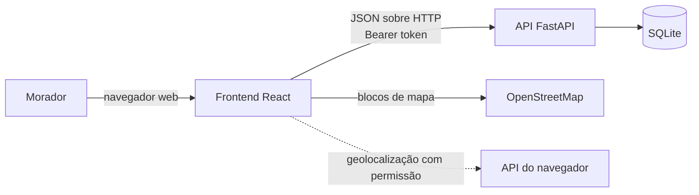
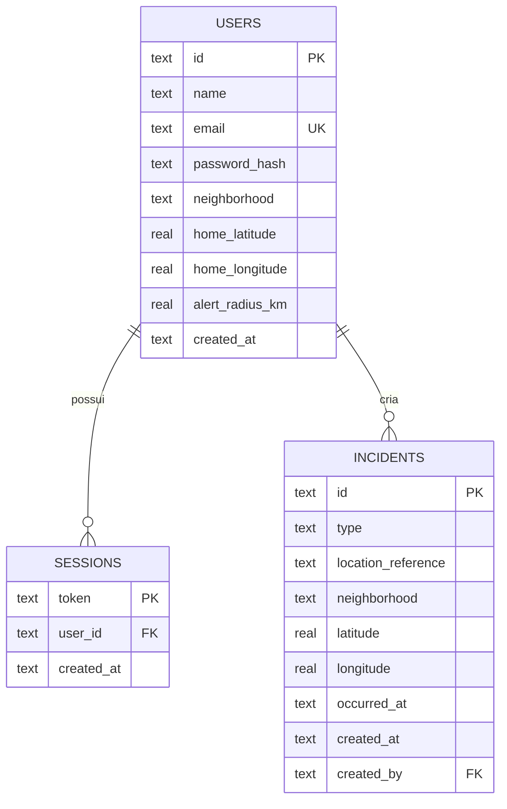
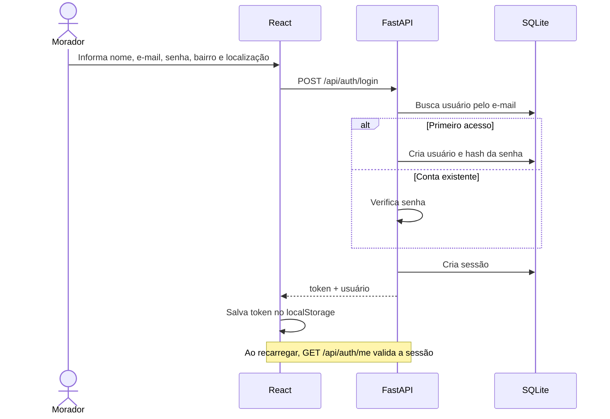
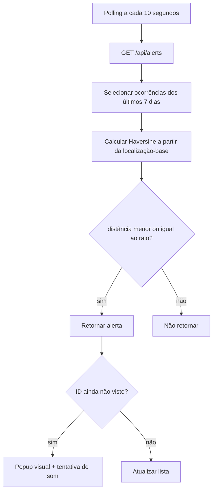

# Arquitetura do Alerta do Bairro

## Estado e escopo

Este documento descreve a arquitetura implementada no MVP em 05/11/2026. A solução é uma aplicação web responsiva com frontend React, API FastAPI e persistência SQLite. Notificação push, moderação, modo offline e integrações oficiais são evoluções futuras.

Os detalhes de rotas estão em [API.md](API.md), e a decisão principal de tecnologia está registrada em [ADR-002](adr/ADR-002-react-fastapi-mapa.md).

## Visão de contexto



### Fronteiras

- **Navegador:** interface, token no `localStorage`, geolocalização, som e renderização do mapa.
- **API:** autenticação, validação, regras de período e raio, cálculo de distância e persistência.
- **SQLite:** usuários, sessões e ocorrências.
- **OpenStreetMap:** provê os blocos visuais do mapa; não recebe os registros da API diretamente.
- **Canais oficiais:** estão fora da arquitetura; não há integração com polícia ou emergência.

## Contêineres e responsabilidades

| Componente | Tecnologia | Responsabilidades |
|---|---|---|
| **Frontend** | React, TypeScript, Vite | Login, dashboard, lista, mapa, registro, preferências, polling e feedback acessível. |
| **Mapa** | React Leaflet, Leaflet, OpenStreetMap | Exibir ocorrências, raio e ponto selecionado; mover para um alerta escolhido. |
| **Cliente HTTP** | `fetch` em `frontend/src/api.ts` | Enviar JSON, anexar Bearer token e normalizar erros da API. |
| **Backend** | FastAPI, Pydantic | Expor endpoints, validar dados, autenticar sessão, calcular distância e aplicar regras. |
| **Persistência** | `sqlite3` e SQLite | Armazenar usuários, sessões e ocorrências em arquivo local. |

## Organização do código

```text
backend/
  app/
    main.py          API, modelos, autenticação, regras e Haversine
    database.py      conexão, caminho do banco e criação das tabelas
  tests/
    test_api.py      fluxo integrado da API
frontend/
  src/
    App.tsx          restauração de sessão e roteamento por estado
    api.ts           cliente HTTP
    types.ts         contratos TypeScript
    components/
      Login.tsx
      Dashboard.tsx
      ReportModal.tsx
      NeighborhoodMap.tsx
    styles.css       layout responsivo e redução de movimento
docs/                contrato, decisões e documentação do projeto
```

## Modelo de dados



### Regras do modelo

- e-mail é único;
- senha é armazenada como hash PBKDF2 com salt;
- raio padrão é 2 km e o intervalo aceito nas preferências é de 0,5 a 10 km;
- coordenadas são validadas nos limites de latitude e longitude;
- o horário de uma nova ocorrência não pode estar mais de cinco minutos no futuro;
- ocorrências retornadas nos fluxos principais são limitadas aos últimos sete dias.

## Fluxos principais

### Autenticação e restauração de sessão



O endpoint chamado “login” também cria uma conta no primeiro acesso. Essa simplificação é própria do MVP e deve ser revista antes de uso público.

### Registro de ocorrência

1. O usuário escolhe um tipo, referência, bairro, horário e ponto aproximado.
2. O frontend converte a data para ISO e envia `POST /api/incidents`.
3. A API valida sessão, campos, coordenadas e horário.
4. O backend persiste a ocorrência e devolve a distância até a localização-base do usuário.
5. O frontend inclui o novo item no mapa e recarrega os alertas próximos.

Não existe upload de foto nem campo de descrição de pessoas.

### Consulta e alertas por proximidade



O dashboard também busca `GET /api/incidents` para exibir no mapa todas as ocorrências recentes. A lista “Ao seu redor” usa somente o resultado filtrado de `/api/alerts`.

## Cálculo geográfico

O backend usa a fórmula de Haversine com raio terrestre de 6.371,0088 km. A fórmula estima a distância em linha reta entre dois pares de latitude e longitude.

Essa distância:

- não considera ruas, relevo, rios, muros ou tempo de deslocamento;
- não representa fronteiras de bairro;
- não deve ser apresentada como localização ou trajeto exato;
- é arredondada para duas casas decimais na resposta da API.

## Contrato HTTP resumido

| Método | Rota | Autenticação | Uso |
|---|---|---|---|
| `GET` | `/api/health` | Não | Saúde da API. |
| `POST` | `/api/auth/login` | Não | Entrar ou criar conta. |
| `GET` | `/api/auth/me` | Sim | Restaurar usuário da sessão. |
| `GET` | `/api/incidents` | Sim | Listar ocorrências recentes; aceita filtros opcionais. |
| `POST` | `/api/incidents` | Sim | Criar ocorrência. |
| `GET` | `/api/alerts` | Sim | Listar ocorrências dentro do raio do usuário. |
| `GET` | `/api/alerts/settings` | Sim | Ler preferências. |
| `PUT` | `/api/alerts/settings` | Sim | Atualizar raio e localização-base. |

O FastAPI publica o contrato OpenAPI em `/openapi.json` e a interface de documentação em `/docs`.

## Segurança implementada

- hash de senha com PBKDF2-HMAC-SHA256, salt aleatório e 210.000 iterações;
- comparação de hash com `hmac.compare_digest`;
- token de sessão aleatório criado com `secrets.token_urlsafe`;
- autenticação Bearer nas rotas de dados;
- validação de entrada com Pydantic;
- chaves estrangeiras ativas no SQLite;
- CORS configurável por `ALERTA_CORS_ORIGINS`;
- ausência de upload e de descrição livre de pessoas.

## Limitações de segurança e operação

- sessão não expira e não existe revogação central além de remover o registro;
- token fica no `localStorage`, o que amplia o impacto de uma falha XSS;
- não há confirmação de e-mail, recuperação de senha ou segundo fator;
- não há rate limiting, moderação, auditoria ou proteção contra automação;
- não há política de backup, retenção, migração ou criptografia do banco;
- SQLite é adequado ao MVP local, não a alta concorrência sem revisão;
- TLS, cabeçalhos de segurança, segredos e observabilidade dependem do ambiente de implantação, ainda não definido;
- dados de demonstração são inseridos quando o banco está vazio;
- dependências de frontend marcadas como `latest` reduzem reprodutibilidade fora do `package-lock.json`.

## Acessibilidade na arquitetura

A lista textual é a principal alternativa de consulta ao mapa. A interface possui rótulos, nomes acessíveis, mensagens de erro e redução de movimento. Entretanto, a escolha do ponto da ocorrência ainda depende de clique no mapa, e o controle de foco dos diálogos precisa ser implementado. O diagnóstico completo está em [02-usuarios-acessibilidade.md](02-usuarios-acessibilidade.md).

## Execução local

### Backend

```powershell
cd backend
python -m venv .venv
.\.venv\Scripts\Activate.ps1
pip install -r requirements.txt
python -m uvicorn app.main:app --reload --port 8000
```

### Frontend

```powershell
cd frontend
npm.cmd install
npm.cmd run dev
```

O Vite encaminha `/api` para `http://localhost:8000` no desenvolvimento. O frontend é servido normalmente em `http://localhost:5173`.

## Evolução recomendada

1. implementar moderação, contestação, retenção e expiração de sessão;
2. corrigir as barreiras P0 de acessibilidade;
3. separar criação de conta e login, com recuperação segura;
4. definir implantação com TLS, banco gerenciado, backups, logs e segredos;
5. adicionar testes de frontend, contrato e segurança;
6. somente depois avaliar push, modo offline e integrações externas.

Qualquer mudança que amplie coleta, compartilhamento ou análise de localização deve atualizar também [03-etica-e-vies.md](03-etica-e-vies.md).
